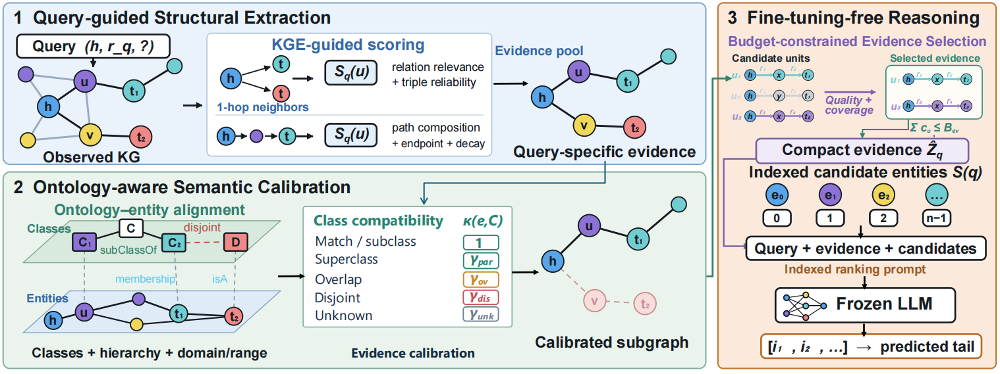
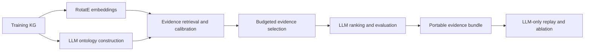

# OASE-KGC

**Ontology-Aware Subgraph Evidence Optimization for Knowledge Graph Completion**

OASE-KGC constructs compact graph evidence for a frozen LLM: RotatE retrieves query-relevant neighbors and paths, ontology constraints calibrate their scores, and a budgeted quality-and-coverage objective selects the final evidence.

**Start with the included evidence bundle:** rerun LLM prediction without training embeddings, constructing an ontology, or retrieving evidence. The bundle contains 200 real FB15k-237 queries and their original responses. This is a **training-sample diagnostic**, not the paper’s held-out test benchmark.



## Quick start: reuse the released evidence

Python 3.10+; CPU is sufficient. Run commands from the repository root.

```bash
pip install -r requirements-quickstart.txt
cp ontology_config.example.json ontology_config.local.json
```

Set `base_url` and `model` in the local configuration. Keep `api_key_env` equal to `LLM_API_KEY`, then set the key in your terminal:

```bash
export LLM_API_KEY='YOUR_API_KEY'
```

The API must support the Chat Completions request/response format. Local configuration and new experiment outputs are ignored by Git.

Validate the included artifacts offline, then try three queries:

```bash
python pipeline.py replay --validate-only
python pipeline.py replay --limit 3 --output results/quickstart3
```

Evaluate all 200 queries:

```bash
python pipeline.py replay --output results/replay200
```

The default bundle is `artifacts/fb15k237-sample200`. No dataset files, ontology file, GPU, or RotatE checkpoint are loaded for replay. The Python source modules remain required. Successful predictions are checkpointed; rerun the same command to resume. Use a new output directory when changing settings.

### Does the evidence help?

Run a controlled comparison with the **same candidates, candidate order, schema hints, model, and decoding settings**, but with evidence text removed:

```bash
python pipeline.py replay --evidence-mode none --output results/replay200_no_evidence
```

Compare `overall.filtered` in the two `metrics.json` files. This measures the contribution of the supplied evidence text to link prediction under a fixed candidate set. It is not a direct human-quality score and does not isolate candidate retrieval or ontology hints. Model/service changes may affect reproducibility.

## Included artifacts and recorded results

| Artifact | Contents |
|---|---|
| `artifacts/fb15k237-sample200/queries.jsonl.gz` | Fixed prompts, candidates, selected evidence and scores, remaining entity order |
| `labels.json` | Gold triples and known answers for metric filtering; never sent to the LLM |
| `reference_predictions.jsonl.gz` | Original responses, parsed/completed orders, predictions and ranks |
| `reference_metrics.json` | Metrics recomputed from the preserved original ranks |
| `manifest.json` | Dataset/model identifiers, source settings, protocol and SHA-256 checksums |
| `results/sample200_tail/` | Original experiment retained intact, including complete evidence pools and per-query results |

The portable bundle is approximately 8.6 MB. It excludes unselected evidence pools and API endpoint/credential configuration; the original run retains the full audit trail. Compression is lossless. Checksums are validated before replay.

**Recorded diagnostic run — 200 tail queries, not held-out test performance:**

| Ranking protocol | MRR | Hits@1 | Hits@3 | Hits@10 |
|---|---:|---:|---:|---:|
| Raw | 0.459045 | 0.340 | 0.510 | 0.695 |
| Filtered | 0.713022 | 0.615 | 0.775 | 0.890 |

Candidate recall: 0.935. Exact unfiltered top-1 accuracy: 0.340. Three responses required ranking completion. Model identifier and original configuration are recorded in the bundle manifest. The original run used a 3000 UTF-8-byte evidence budget, not exact tokenizer counting.

The 200 target edges were removed from the evidence graph. However, the ontology was constructed using these training samples, and the embeddings may also have seen them. These numbers must not be presented as independent test-set results or as a reproduction of the paper’s main table.

## End-to-end pipeline



`pipeline.py` provides one entry point. Existing module scripts remain callable for compatibility.

| Command | Purpose |
|---|---|
| `train` | Train/load RotatE via `model/KGE_model.py` |
| `ontology` | Extract entity types, class axioms and relation schemas |
| `evidence` | Save evidence and prompts without calling a prediction LLM |
| `evaluate` | Build evidence, call the LLM, and compute full-entity metrics |
| `export` | Copy a completed evaluation into a reusable evidence bundle |
| `replay` | Evaluate the fixed bundle with an LLM, without upstream computation |

### Build a new experiment

Install the construction dependencies; choose a PyTorch build appropriate for your server if needed:

```bash
pip install -r requirements.txt
```

The previous broad environment snapshot is preserved as `requirements-legacy.txt`; it is not needed for the supported pipeline. A local Hugging Face tokenizer additionally requires `transformers`.

**1. Train embeddings** (skip if compatible training-only weights already exist):

```bash
python pipeline.py train --mode train \
  --data_path dataset/FB15k-237 --dataset_name FB15k-237 \
  --hidden_dim 200 --gamma 9 --learning_rate 0.00005 --max_steps 100000
```

The export directory contains `entity_embedding.npy`, `relation_embedding.npy` and `config.json`. Verify that IDs match the dataset and that embedding training used only training edges.

**2. Construct the ontology from the training graph:**

```bash
python pipeline.py ontology --data-path dataset/FB15k-237 \
  --config ontology_config.local.json --mode all
```

Use `--mode sample` for a 200-edge construction smoke test. Missing classes remain unknown. This sampling controls ontology construction, not the number of evaluation queries.

**3. Retrieve evidence and evaluate a reproducible test subset:**

```bash
python pipeline.py evaluate \
  --data-path dataset/FB15k-237 \
  --ontology import/ontology/FB15k-237/all/ontology.json \
  --embeddings import/KGE_model/FB15k-237 \
  --split test --sample-size 200 --seed 2026 --prediction both \
  --encoding o200k_base --token-budget 3000 \
  --output results/test200
```

Remove `--sample-size 200` for the complete test split. Use `--limit 200` instead for the first 200 triples, or `--triples targets.json` for custom `[head, relation, tail]` IDs. `both` produces two queries per triple. API keys are read from the same local configuration/environment as quick start.

For evidence only, use `python pipeline.py evidence --help`. All evidence comes from train. The evaluator records training overlap and rejects mixing different inputs/settings in one checkpoint directory.

**4. Preserve evidence for other researchers:**

```bash
python pipeline.py export --run-dir results/test200 \
  --data-path dataset/FB15k-237 --output artifacts/fb15k237-test200
python pipeline.py replay --bundle artifacts/fb15k237-test200 \
  --output results/test200_replay
```

Export reads a completed `evaluate` run and copies evidence into a new directory; it never deletes or overwrites the original run. Git-track `artifacts/` to distribute the bundle. Raw evidence-only JSONL is not an export input because it lacks gold/filter labels and the complete ranking remainder.

## Evaluation and outputs

Outputs include raw/filtered MR, MRR, Hits@1/3/10, exact top-1 accuracy, candidate recall, and fallback counts. LLM-ranked candidates are followed by remaining entities in their original RotatE order. Queries whose targets are absent from the candidate set are still counted. Known-answer filtering occurs only during scoring.

Each output directory contains:

- `metrics.json`: aggregate metrics and complete/partial status;
- `predictions_sorted.json` and `.csv`: correct-first prediction reports;
- `per_query/`: checkpointed predictions, raw LLM replies, rankings and evidence;
- `manifest.json`: input/protocol/model fingerprint for safe resumption.

“Correct” means the unfiltered top prediction equals the current target. A query can have filtered rank 1 while exact top-1 is false when another known answer was predicted first. Reports reorder **samples**, never the model’s rankings.

Implementation choices to report: direct edges matching the query relation at its anchor are conservatively masked; schema conjunction uses products of compatibility scores; missing ontology information uses the unknown score. Replay keeps the selected evidence and candidates fixed. No exact reproduction of the paper’s main results is claimed by the bundled diagnostic.

## Repository layout

```text
pipeline.py                    unified command-line entry
extract_ontology.py            ontology construction and caching
evidence_pipeline.py           retrieval, calibration, budget selection
evaluate_sample.py             general split/subset evaluation (historical filename)
artifacts/fb15k237-sample200/    portable, checksummed quick-start evidence
results/sample200_tail/         preserved original diagnostic experiment
model/KGE_model.py             RotatE training and export
src/kg_loader.py               dataset metadata loader
dataset/                       FB15k-237 and WN18RR input files
tests/                         offline unit/integration tests
```

`run.py`, `model/extractor.py`, `model/filter.py`, `model/compressor.py`, and `src/evaluator.py` are retained as legacy code. They are not the supported paper-aligned entry point; in particular, the legacy extractor includes gold-tail heuristics. Use `pipeline.py` for the documented workflow.

## Verification and reproducibility

```bash
python -m unittest discover -s tests -v
python pipeline.py replay --validate-only
```

Offline tests cover ontology compatibility, evidence scores/budgets, ranking metrics, export/replay, checksum verification, checkpoint reuse and evidence removal. CI runs on Python 3.10/3.12 without API credentials. A real provider call is still needed to measure a new LLM; offline tests do not establish API compatibility or semantic performance.

Further documentation: [ontology workflow (中文)](ONTOLOGY_GUIDE.md), [contribution and experiment guidelines](CONTRIBUTING.md), [artifact card](artifacts/fb15k237-sample200/README.md).

## Paper and attribution

This repository accompanies **OASE-KGC: Ontology-Aware Subgraph Evidence Optimization for Knowledge Graph Completion**. Publication metadata and a verified citation will be added when available; no acceptance status is asserted here. The benchmark datasets retain their upstream attribution and usage terms. No new software license is assigned by this repository cleanup.
